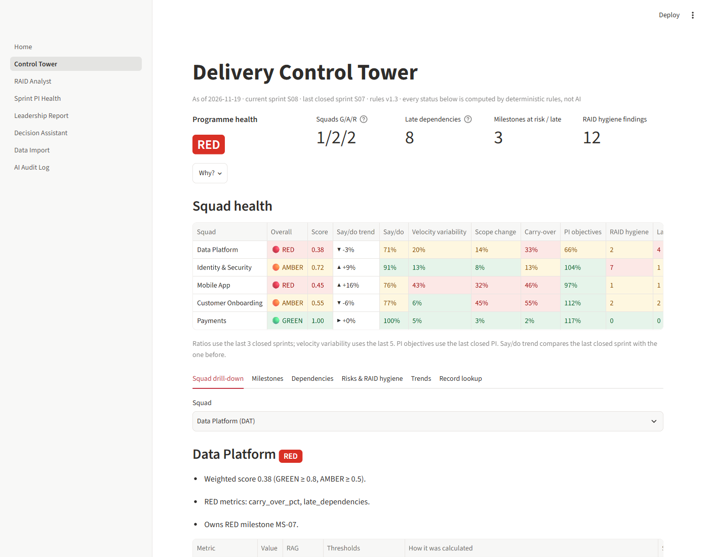
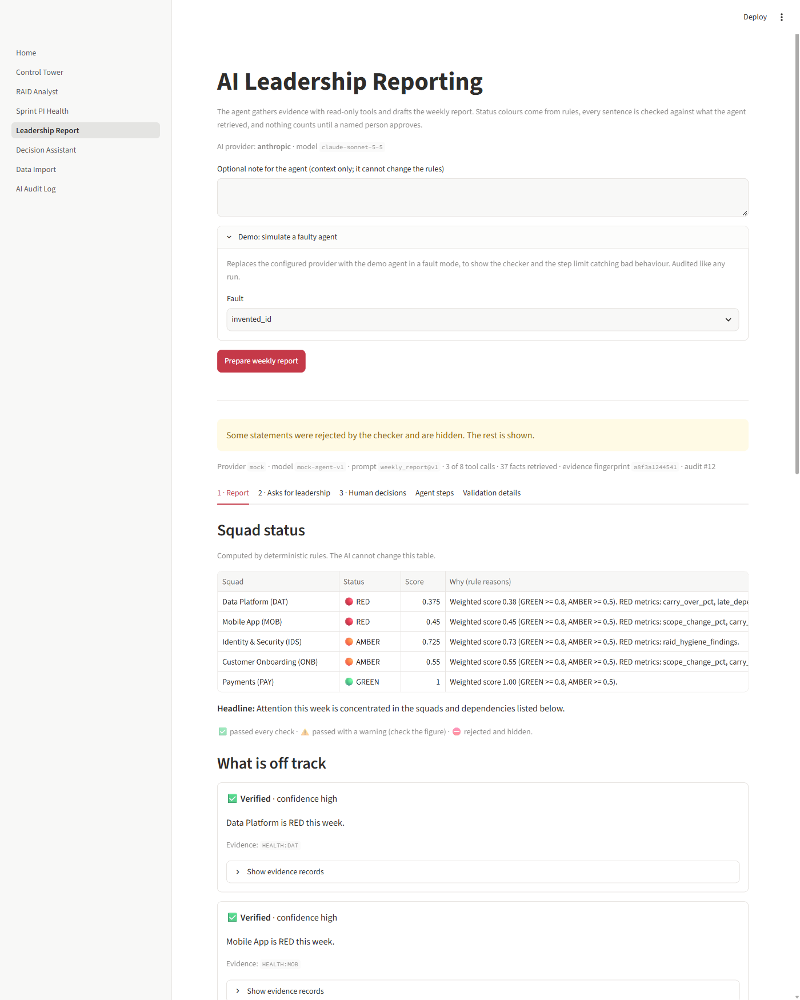

# AI Agile Delivery Manager Assistant

An independent portfolio project that simulates an enterprise technology programme
("Project Meridian", five Agile squads) using **synthetic data only**.

**Principle: rules compute, AI interprets, humans decide.** All metrics, RAG statuses and
escalation candidates come from deterministic, tested Python rules. The AI only explains and
recommends from a cited "fact pack"; every statement is validated against the facts it cites,
and suggested actions take effect only when a named person approves them.

## Modules
1. Delivery Control Tower
2. AI RAID Analyst
3. Sprint and PI Health Analyser
4. AI Leadership Reporting
5. Delivery Decision Assistant

## Screenshots
Synthetic data only. The first shows the non-AI Control Tower; its statuses come from tested rules.
The second shows the agent's weekly report, where the squad table is built by rules and the
checker has hidden a statement it could not verify (a free demo run using the fault demo option).





## Quick start (Windows PowerShell, Python 3.11+)
```powershell
git clone https://github.com/pratibha1990ps/ai-agile-delivery-manager-assistant.git
cd ai-agile-delivery-manager-assistant
python -m venv .venv
.\.venv\Scripts\Activate.ps1
pip install -e ".[dev]"
pytest
streamlit run app/Home.py
```

## AI RAID Analyst (Phase 3)
Open **AI RAID Analyst**, choose a scope (programme or squad) and one of five questions, then
**Analyse**. Results are shown in four separate layers:

1. **Verified facts** computed by the rules (shown even if the AI fails)
2. **AI interpretation**: findings with citation chips, marked verified, flagged or rejected
3. **Suggested actions**: approve or reject, with your name and a comment
4. **Human decisions**: the review history

Every run is recorded on **AI Audit Log** (provider, model, prompt version, fact pack and its
SHA-256 fingerprint, raw answer, validation outcome, reviews). The *Demo: simulate a faulty AI
response* option shows the validator rejecting invented IDs, wrong numbers and RAG overrides.

## AI Leadership Reporting: the Weekly Delivery Report Agent (Phase 5)
Open **Leadership Report** and click **Prepare weekly report**. This is an *agent*: the AI chooses
which of six read-only tools to call next (programme health, squad metrics, RAID items, late
dependencies, escalation candidates, milestones), then drafts the report.

- **Guardrails:** at most 8 tool calls, repeated calls refused, no tool can change data.
- **Evidence:** a statement may only cite facts the agent actually retrieved; the checker marks
  each one verified, flagged or rejected, and rejected statements are hidden.
- **Status table:** built by rules from the health facts. The AI cannot change it.
- **Human decision:** each ask is approved or rejected by a named person and logged on the audit page.
- **Free demo:** with the `mock` provider a built-in demo agent runs offline. Open *Demo: simulate
  a faulty agent* to see the checker and the step limit catch bad behaviour.

Not built yet: editing the report text and exporting it to Markdown or Word.

## LLM configuration
Copy `config/llm.yaml.example` to `config/llm.yaml` (git-ignored). The default provider is
`mock`: deterministic templates, not a language model, with no key and no cost. Optional real
providers (`pip install -e ".[llm]"`):

| Provider | Settings |
|---|---|
| Ollama / LM Studio (free, local) | `provider: openai_compatible`, `base_url: http://localhost:11434/v1`, `model: llama3.1` |
| OpenAI-compatible hosted service | `provider: openai_compatible`, `base_url`, `model`, `api_key_env: OPENAI_API_KEY` |
| Anthropic Claude | `provider: anthropic`, `model: claude-opus-5-5`, `api_key_env: ANTHROPIC_API_KEY` (or rely on the SDK's own credential lookup) |

Keys are read from environment variables at call time and never written to config or logs.
**Local models:** a programme-wide fact pack is roughly 8-10k tokens. Many local models default
to a smaller context window and silently cut the prompt; lower `ai.max_facts` in
`config/settings.yaml` (for example to 30) or raise the model's context size.

## Synthetic data
```powershell
python -m adm.synthetic.generate   # writes data/synthetic/*.csv, programme_data.xlsx
```
Then open **Data Import → Load demo dataset**. `data/samples/dirty_import.xlsx` shows
row-level validation errors. Planted scenarios (the golden test answers) are listed in
`src/adm/synthetic/scenarios.py`.

## Development notes
- Streamlit reloads files under `app/` automatically, but not the `adm` package under `src/`.
  Restart `streamlit run` after changing rules, services or AI code.
- Thresholds and weights live in `config/thresholds.yaml` (versioned; currently 1.3).
- Prompts live in `src/adm/ai/prompts/<id>/<version>.md`. Published versions are immutable
  (a test pins their SHA-256); change wording by adding a new version.

## Status
- Phase 0 (foundations): done
- Phase 1 (schema, synthetic data, validated CSV/Excel import with lineage): done
- Phase 2 (rules engine + Delivery Control Tower, non-AI MVP): done. Golden tests in
  `tests/scenario/` prove every planted scenario is detected and the control squad
  (Payments) stays GREEN.
- Phase 3 (AI foundation + AI RAID Analyst + AI Audit Log): done. Provider abstraction (mock,
  OpenAI-compatible, Anthropic), fact packs, versioned prompts, grounding validator, audit log
  and human review. All tests run without network access or a paid API.
- Phase 5 (Weekly Delivery Report Agent): agent, checker, page and tests done; report export not
  built. One real run with Claude Sonnet 5.5 gave 12 statements verified and 3 rejected by the
  checker (about $0.27). That is a single sample, not a measured quality rate.

## Limitations
- The default **Mock** provider is a deterministic stand-in, not a language model. It proves
  the pipeline end to end at no cost; answer quality needs a real model (Ollama, OpenAI or
  Anthropic) and is not measured here.
- The grounding validator is pattern-based. It proves an answer is traceable to cited facts;
  it cannot judge whether the advice is wise. Human review is the control for that.
- All data is fictional. This is not client or employer work.

## Licence
MIT, see [LICENSE](LICENSE).

Full product documentation (vision, discovery, architecture and ADRs, backlog, evidence log)
is in [`docs/`](docs/README.md).
