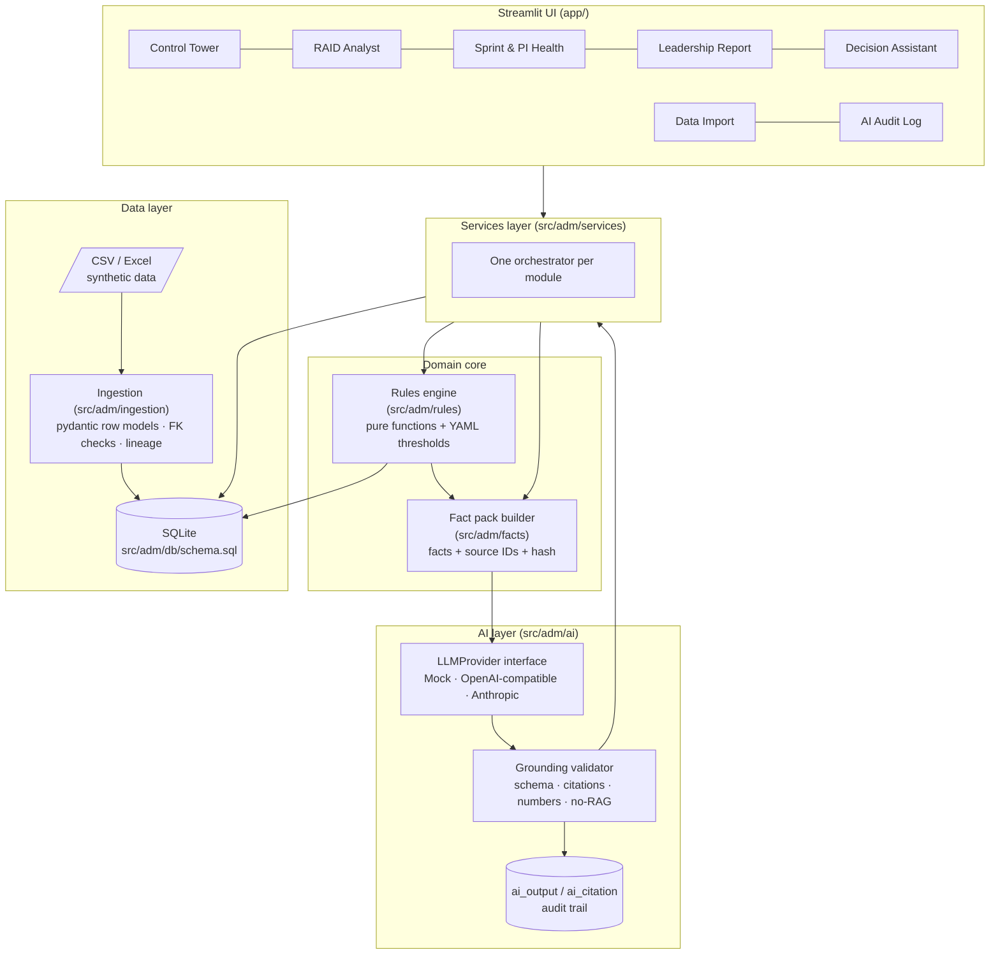
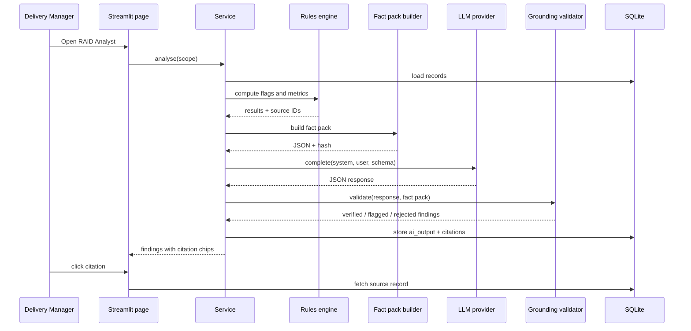
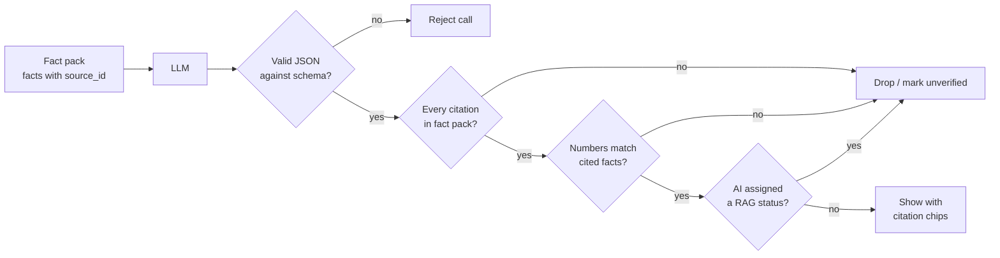
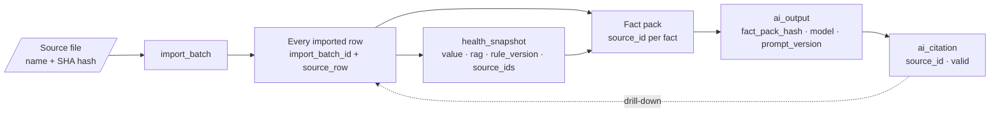
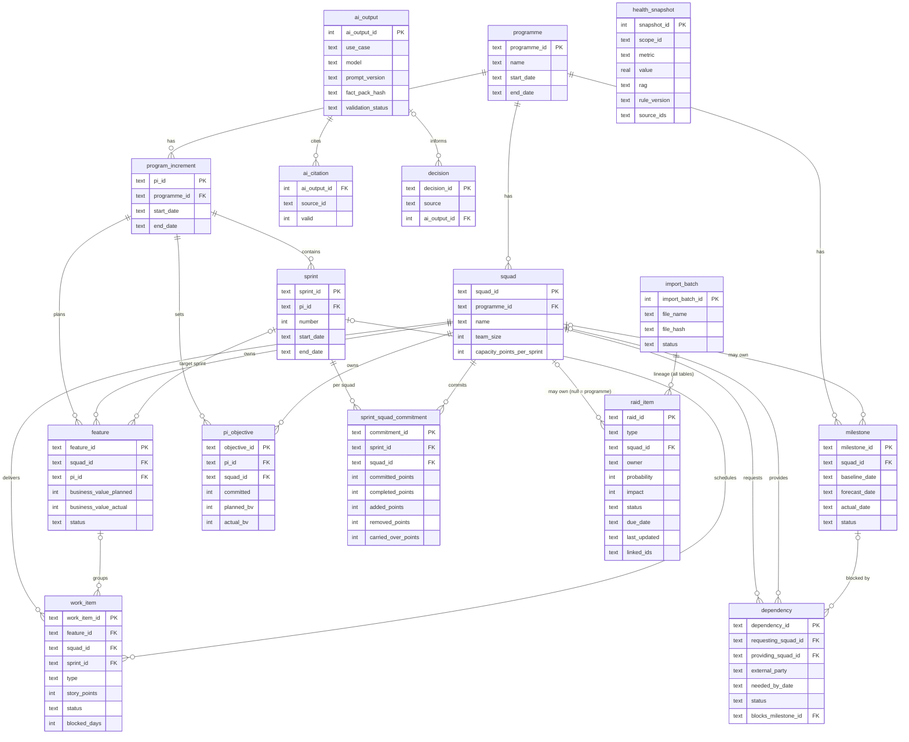
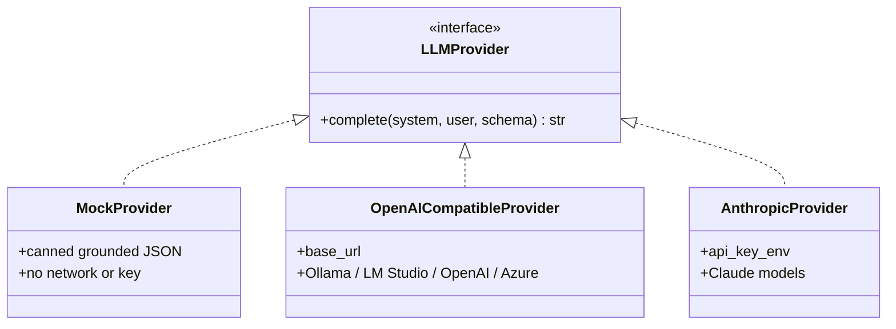

# 03 · Architecture & Solution Design

**Guiding principle: rules compute, AI interprets.** Deterministic, tested Python produces every number, RAG status and flag. The LLM only explains, summarises and recommends, using a cited fact pack. The app validates its output before showing it.

## 1. Solution architecture



### Request flow for an AI-assisted view



### Key design decisions (summary)

| Concern | Decision | ADR |
|---|---|---|
| Storage | SQLite, single file | [ADR-001](#adr-001--sqlite-as-the-database) |
| Data access | stdlib `sqlite3` with repository functions, no ORM | [ADR-002](#adr-002--stdlib-sqlite3-without-an-orm) |
| UI | Streamlit multipage app | [ADR-003](#adr-003--streamlit-for-the-ui) |
| LLM default | Mock provider; real providers are opt-in | [ADR-004](#adr-004--mock-llm-provider-as-the-default) |
| Responsibility split | Rules decide; AI interprets | [ADR-005](#adr-005--rules-engine-separated-from-the-ai-layer) |
| AI safety | Structured JSON plus a grounding validator | [ADR-006](#adr-006--structured-json-output-plus-a-grounding-validator) |
| Thresholds | Versioned YAML | [ADR-007](#adr-007--thresholds-in-versioned-yaml) |
| Import | All-or-nothing by default | [ADR-008](#adr-008--all-or-nothing-import-by-default) |

## 2. Application module breakdown

| Module | Deterministic (rules) | AI (interpretation) |
|---|---|---|
| **Delivery Control Tower** | Squad RAG grid, milestone status, critical-path dependencies, top risks, trend vs. last sprint, drill-down | Optional "what changed this week" summary, with citations |
| **AI RAID Analyst** | Missing owner, overdue actions, stale items, high-score risks without mitigation, ageing issues, risks past trigger date, duplicate candidates | Themes, patterns across squads, suggested mitigations, escalation candidates |
| **Sprint & PI Health Analyser** | Say/do, velocity and coefficient of variation, scope change %, carry-over %, blocked days, PI objective achievement, capacity utilisation | Squad narrative, root causes linked to evidence, coaching suggestions |
| **AI Leadership Reporting** | Overall RAG, KPIs, milestones, top risks, decisions needed | Executive summary and highlights/lowlights; edit → approve → export (Markdown/DOCX) |
| **Delivery Decision Assistant** | What-if impact on capacity, dates and dependent items | Option analysis and recommendation; logged to the `decision` table |
| Data Import *(supporting)* | Upload, validate, row-level error report, lineage | — |
| AI Audit Log *(supporting)* | Every AI call: model, prompt version, fact-pack hash, validation | — |

**Package layout**: real paths on disk, with some still placeholders:

| Path | Responsibility | State |
|---|---|---|
| [`src/adm/config.py`](../src/adm/config.py) | Typed loader for settings, thresholds and LLM config | Built (Phase 0) |
| [`src/adm/rules/rag.py`](../src/adm/rules/rag.py) | The single place a RAG status is assigned | Built (Phase 0) |
| [`src/adm/db/schema.sql`](../src/adm/db/schema.sql) | SQLite schema | Built (Phase 1) |
| [`src/adm/db/connection.py`](../src/adm/db/connection.py) | Connect, init, reset, `ADM_DB_PATH` override | Built (Phase 1) |
| [`src/adm/db/repositories.py`](../src/adm/db/repositories.py) | Read-side queries and cross-entity record lookup | Built (Phase 1) |
| [`src/adm/ingestion/schemas.py`](../src/adm/ingestion/schemas.py) | Pydantic row models and the entity registry | Built (Phase 1) |
| `src/adm/ingestion/loaders.py`, `validator.py`, `importer.py` | CSV/Excel loading, cross-entity validation, import with lineage | In progress (Phase 1) |
| `src/adm/synthetic/` | Seeded synthetic data generator and planted scenarios | In progress (Phase 1) |
| `src/adm/facts/`, `ai/`, `services/`, `reporting/` | Later phases | Empty packages |
| [`app/Home.py`](../app/Home.py), `app/pages/*` | Streamlit UI | Home built; module pages are placeholders |

## 3. Anti-hallucination contract



| # | Control | What it prevents |
|---|---|---|
| 1 | **Restricted input**: the LLM sees only the fact pack | Using outside or invented knowledge |
| 2 | **Structured output**: `{findings:[{text, citations, confidence}], recommendations:[…]}` | Uncheckable free text |
| 3 | **Citation check**: every ID must exist in the fact pack | Invented records |
| 4 | **Number check**: numbers in the text must match the cited facts | Wrong dates, counts or percentages |
| 5 | **No AI status decisions**: wording that sets a status is rejected | AI overriding the rules engine |
| 6 | **Visible verification**: unverified findings are hidden or labelled "⚠ unverified" | Silent trust |
| 7 | **Human approval** for reports and decisions | Unchecked output reaching leadership |
| 8 | **Audit trail**: provider, model, prompt version, fact-pack hash, raw response | Unexplainable outputs |
| 9 | **Adversarial tests**: fake IDs, wrong numbers, invented RAG, malformed JSON | Validator regressions |

**Example fact pack** (from the discovery Q&A):

```json
{
  "use_case": "raid_analysis",
  "as_of": "2026-11-19",
  "scope": "squad:IDS",
  "facts": [
    {"source_id": "RAID-R-031", "type": "risk", "score": 20, "owner": null, "mitigation": null},
    {"source_id": "RULE:RAID_NO_MITIGATION:RAID-R-031", "type": "rule_result", "result": "FLAGGED"}
  ]
}
```

## 4. Traceability and lineage design



| Question an auditor asks | Answered by |
|---|---|
| Which file did this record come from, and which row? | `import_batch_id` and `source_row` on every imported table |
| Was this file imported before? | `import_batch.file_hash` (re-import is idempotent) |
| Why is this squad Amber? | `health_snapshot.source_ids` and `rule_version` |
| What exactly did the AI see? | `ai_output.fact_pack_json` and `fact_pack_hash` |
| Which claims were verified? | `ai_citation.valid` |
| Who approved the report? | `ai_output.approved_by` / `approved_at` |

## 5. Database schema

The diagram below reflects [`src/adm/db/schema.sql`](../src/adm/db/schema.sql) as it exists now. Lineage columns (`import_batch_id`, `source_row`, `created_at`, `updated_at`) are on every imported table and are left out of the diagram for readability.



**Changes from the planned schema made during Phase 1** (documented for transparency):

| Area | Plan | As built | Reason |
|---|---|---|---|
| Dependency direction | `from_squad_id` / `to_squad_id` | `requesting_squad_id` / `providing_squad_id`, plus `external_party`, `delivered_date` and `blocks_milestone_id` | Clearer meaning; supports external suppliers and milestone impact |
| RAID types | R/A/I/D | `RISK`, `ASSUMPTION`, `ISSUE`, `ACTION`, `DECISION` | Supports both actions ("overdue actions") and assumptions |
| Sprint commitment | Composite key | `commitment_id` surrogate key, plus `completed_points` and `carried_over_points`, unique on (sprint, squad) | Gives each sprint result a citable ID |
| Milestone | `status` | `status` limited to `Planned` / `Complete`, plus `squad_id` | Lateness is *calculated* by rules, not reported |
| Import batch | One entity per batch | `entities`, `warning_count`, and `status` (`imported` / `rejected` / `partial`) | One file can hold several entities (Excel sheets) |

Source-side status fields are kept factual (for example Planned or Complete). Derived judgements such as "late" or "at risk" are always calculated by the rules engine.

## 6. Synthetic data design

**Scenario:** "Project Meridian", a fictional retail-bank digital modernisation programme. It covers 2 PIs × 5 two-week sprints, with the as-of point at PI 2, Sprint 3 ([`config/settings.yaml`](../config/settings.yaml) sets `as_of_date: 2026-11-19`).

| Squad | Personality (planted pattern) | Expected health |
|---|---|---|
| Payments | High performer, stable velocity: the **control group** | Green |
| Customer Onboarding | Scope creep: high mid-sprint additions, falling say/do | Amber |
| Data Platform | Blocked by dependencies; late milestone | Red |
| Mobile App | Volatile velocity, high carry-over, defect spike | Amber |
| Identity & Security | Risk-heavy: high-score risks without owner or mitigation; overdue actions | Amber/Red |

| Design element | Approach |
|---|---|
| Volumes (target) | 10 sprints, about 40 features, about 650 work items, 50 PI objectives, about 90 RAID items, about 35 dependencies (8 late), 12 milestones |
| Determinism | Fixed random seed, so runs are reproducible and tests are stable |
| Realism | Templated banking vocabulary; no Faker dependency |
| Outputs | One CSV per entity plus one Excel workbook (one sheet per entity), the same files a user would import |
| Planted scenarios | Known facts, for example "RAID-R-031 is high-score with no mitigation" or "DEP-012 is 3 weeks late and blocks MS-07". They double as **golden test expectations** |
| Negative sample | A "dirty" file (bad dates, unknown squad, missing fields) to demonstrate validation |

> Status: implemented in [`src/adm/synthetic/generate.py`](../src/adm/synthetic/generate.py). It produces 634 work items and uses one independent seeded stream per entity. Future sprints (S09–S10) contain only planned `To Do` backlog with no commitment rows. Evidence is in [05_delivery_evidence_log.md](05_delivery_evidence_log.md#h--generator-gap-closure-srcadmsyntheticgeneratepy).

## 7. LLM provider abstraction



| Setting ([`config/llm.yaml.example`](../config/llm.yaml.example)) | Default |
|---|---|
| `provider` | `mock` (one of `mock`, `openai_compatible`, `anthropic`) |
| `model` | `mock-grounded-v1` |
| `temperature` | `0.0` |
| `base_url` / `api_key_env` | `null`. Keys are read from environment variables at call time and never stored in config |

The config loads with this precedence ([`src/adm/config.py`](../src/adm/config.py)): `config/llm.yaml` (git-ignored), then `config/llm.yaml.example`, then the built-in mock default. The provider SDKs are an optional `[llm]` extra in [`pyproject.toml`](../pyproject.toml).

## 8. Testing strategy

| Layer | Approach | State |
|---|---|---|
| Config | Loads; rejects inverted thresholds and weights that don't sum to 1.0; LLM precedence | ✅ [`tests/unit/test_config.py`](../tests/unit/test_config.py) |
| RAG rules | Boundary tests (for example 0.85 vs 0.849) in both directions | ✅ [`tests/unit/test_rag.py`](../tests/unit/test_rag.py) |
| UI smoke | `streamlit.testing.v1.AppTest` renders every page without exceptions | ✅ [`tests/ui/test_pages_smoke.py`](../tests/ui/test_pages_smoke.py) |
| Ingestion | Valid import, dirty-file errors per row, idempotent re-import, lineage | Phase 1 |
| Repositories / integration | In-memory SQLite; import → rules → snapshot | Phases 1–2 |
| Scenario / golden | Every planted fact detected; Payments stays Green | Phase 2 |
| AI grounding | Adversarial canned responses must be rejected or flagged | Phase 3 |
| Prompt regression | Snapshot of the rendered prompt and fact pack | Phase 3 |
| Optional live eval | Citation-validity rate against the real LLM (not in CI) | Phase 3+ |
| CI | GitHub Actions running ruff and pytest; no keys needed | Phase 7 |

## 9. Architecture Decision Records

### ADR-001 — SQLite as the database
- **Context:** A single-user, local portfolio app with about 1,000 rows of synthetic data. It must be free and run with no setup.
- **Decision:** Use SQLite (one file, `data/adm.db`, git-ignored).
- **Consequences:** ✅ No server, no setup, deploys on the free Streamlit Cloud. ⚠️ No concurrent multi-user writes. Plain SQL in repository functions keeps the path to PostgreSQL open.

### ADR-002 — stdlib sqlite3 without an ORM
- **Context:** The schema is small and stable, and the goal is transparency and few dependencies.
- **Decision:** Use the stdlib `sqlite3` module, a `schema.sql` file, and repository functions returning dicts or DataFrames.
- **Consequences:** ✅ The SQL is visible and the code is simple to test. ⚠️ Mapping is manual and there is no migration tool (the schema is recreated with `reset_db` while in development).

### ADR-003 — Streamlit for the UI
- **Context:** A data-heavy dashboard built by one Python developer, needing fast iteration and free hosting.
- **Decision:** A Streamlit multipage app (`app/Home.py` plus `app/pages/`).
- **Consequences:** ✅ Pure Python, built-in charts, tables and file upload, a testing API (`AppTest`) and free Community Cloud hosting. ⚠️ Limited control over layout. Business logic is kept out of pages so the UI could be replaced.

### ADR-004 — Mock LLM provider as the default
- **Context:** The brief required the LLM to be configured separately and no paid tools. Tests must be deterministic.
- **Decision:** A provider interface with `mock` as the default. OpenAI-compatible (including free local Ollama) and Anthropic are opt-in.
- **Consequences:** ✅ Zero cost, works offline, deterministic CI, and reviewers need no keys. ⚠️ Mock output only shows the pattern, so a live evaluation script is needed to measure real model behaviour.

### ADR-005 — Rules engine separated from the AI layer
- **Context:** Delivery health must be repeatable and auditable, and the brief says AI must never invent facts.
- **Decision:** Pure-function rules compute every metric and RAG status. AI only interprets rule outputs through fact packs and cannot set a status.
- **Consequences:** ✅ The app is testable and explainable, and works with AI turned off. ⚠️ Two layers to maintain, and AI insight is limited to what the rules expose.

### ADR-006 — Structured JSON output plus a grounding validator
- **Context:** Free-text LLM output can't be checked automatically.
- **Decision:** Require schema-validated JSON in which each finding has citations. The validator checks citations, numbers and that no RAG status was assigned. Failures are dropped or marked unverified.
- **Consequences:** ✅ Every displayed fact is traceable. ⚠️ Some valid insights may be filtered out, and the number check needs a tolerance policy (OQ2).

### ADR-007 — Thresholds in versioned YAML
- **Context:** RAG cut-offs are business policy and will be tuned over time.
- **Decision:** Keep thresholds and weights in [`config/thresholds.yaml`](../config/thresholds.yaml) with a `version`, validated by pydantic (direction order; weights sum to 1.0). The version is stored with each `health_snapshot`.
- **Consequences:** ✅ Policy changes are reviewable in git and need no code change. Historic snapshots stay explainable. ⚠️ Config errors must fail fast, which the validation covers.

### ADR-008 — All-or-nothing import by default
- **Context:** A partial import can leave orphaned or inconsistent delivery data, which would then produce misleading health results.
- **Decision:** By default, validate everything first. If any error is found, import nothing and return a row-level error report. Partial import is an explicit opt-in. Files are tracked by hash so re-imports are idempotent.
- **Consequences:** ✅ The database is always internally consistent, and errors are actionable (file, row, field, message). ⚠️ One bad row blocks the whole file unless partial mode is chosen.

> ADR-008 records the approach chosen for Phase 1 ingestion. Its implementation is in progress.
