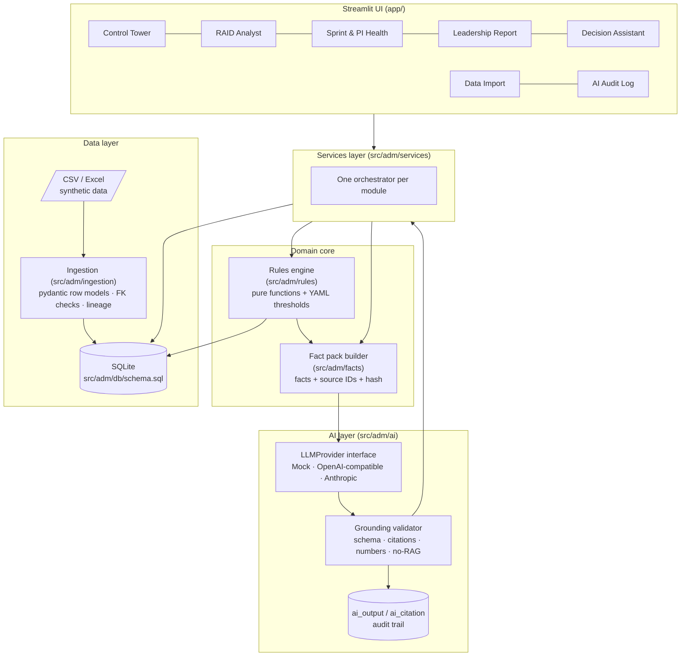
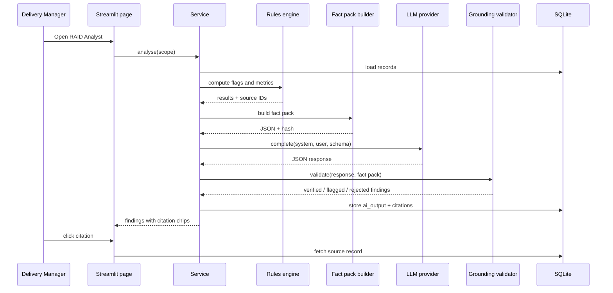
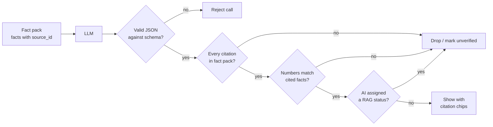
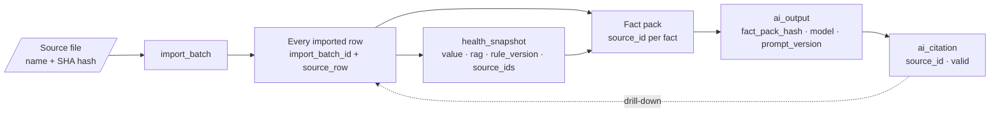
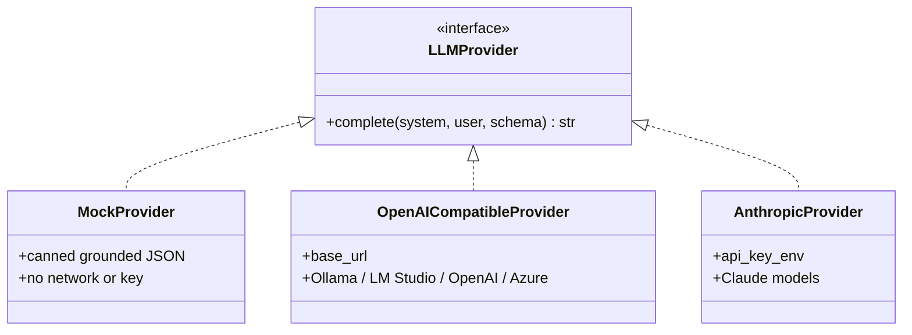
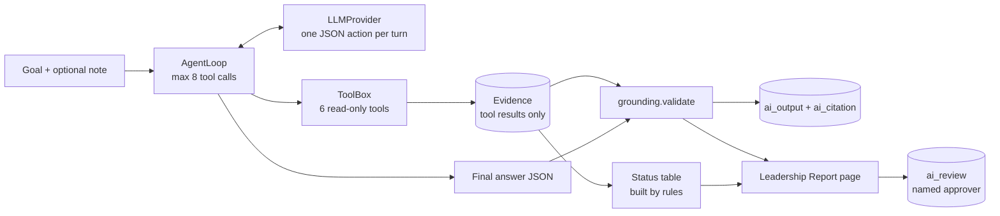

# 03 · Architecture & Solution Design

**Guiding principle: rules compute, AI interprets.** Deterministic, tested Python produces every number, RAG status and flag. The LLM only explains, summarises and recommends, using a cited fact pack. The app validates its output before showing it.

## 1. Solution architecture



### Request flow for an AI-assisted view



### Key design decisions (summary)

| Concern | Decision | ADR |
|---|---|---|
| Storage | SQLite, single file | [ADR-001](#adr-001--sqlite-as-the-database) |
| Data access | stdlib `sqlite3` with repository functions, no ORM | [ADR-002](#adr-002--stdlib-sqlite3-without-an-orm) |
| UI | Streamlit multipage app | [ADR-003](#adr-003--streamlit-for-the-ui) |
| LLM default | Mock provider; real providers are opt-in | [ADR-004](#adr-004--mock-llm-provider-as-the-default) |
| Responsibility split | Rules decide; AI interprets | [ADR-005](#adr-005--rules-engine-separated-from-the-ai-layer) |
| AI safety | Structured JSON plus a grounding validator | [ADR-006](#adr-006--structured-json-output-plus-a-grounding-validator) |
| Thresholds | Versioned YAML | [ADR-007](#adr-007--thresholds-in-versioned-yaml) |
| Import | All-or-nothing by default | [ADR-008](#adr-008--all-or-nothing-import-by-default) |
| AI evidence | Fact pack chosen by scope + focus, capped, fingerprinted | [ADR-009](#adr-009--fact-pack-retrieval-by-scope-and-focus) |
| Human review | Additive `ai_review` table with full history | [ADR-010](#adr-010--additive-ai_review-table-for-human-decisions) |
| Escalation and exposure | Deterministic rules; exposure is squad-level | [ADR-011](#adr-011--escalation-and-exposure-are-rules-not-ai) |
| Prompts | Versioned files, immutable once published | [ADR-012](#adr-012--versioned-immutable-prompt-files) |
| Agent loop | Plain-JSON actions through the provider interface | [ADR-013](#adr-013--the-agent-speaks-plain-json-through-the-provider-interface) |
| Agent evidence | Read-only tools; evidence is only what the tools returned | [ADR-014](#adr-014--read-only-tools-and-tool-results-as-the-only-evidence) |
| Agent limits | Hard caps on calls and turns; a run never raises | [ADR-015](#adr-015--hard-guardrails-on-every-agent-run) |

## 2. Application module breakdown

| Module | Deterministic (rules) | AI (interpretation) |
|---|---|---|
| **Delivery Control Tower** | Squad RAG grid, milestone status, critical-path dependencies, top risks, trend vs. last sprint, drill-down | Optional "what changed this week" summary, with citations |
| **AI RAID Analyst** | Missing owner, overdue actions, stale items, high-score risks without mitigation, ageing issues, risks past trigger date, duplicate candidates | Themes, patterns across squads, suggested mitigations, escalation candidates |
| **Sprint & PI Health Analyser** | Say/do, velocity and coefficient of variation, scope change %, carry-over %, blocked days, PI objective achievement, capacity utilisation | Squad narrative, root causes linked to evidence, coaching suggestions |
| **AI Leadership Reporting** | Overall RAG, KPIs, milestones, top risks, decisions needed | Executive summary and highlights/lowlights; edit → approve → export (Markdown/DOCX) |
| **Delivery Decision Assistant** | What-if impact on capacity, dates and dependent items | Option analysis and recommendation; logged to the `decision` table |
| Data Import *(supporting)* | Upload, validate, row-level error report, lineage | — |
| AI Audit Log *(supporting)* | Every AI call: model, prompt version, fact-pack hash, validation | — |

**Package layout**: real paths on disk, with some still placeholders:

| Path | Responsibility | State |
|---|---|---|
| [`src/adm/config.py`](../src/adm/config.py) | Typed loader for settings, thresholds and LLM config | Built (Phase 0) |
| [`src/adm/rules/rag.py`](../src/adm/rules/rag.py) | The single place a RAG status is assigned | Built (Phase 0) |
| [`src/adm/db/schema.sql`](../src/adm/db/schema.sql) | SQLite schema | Built (Phase 1) |
| [`src/adm/db/connection.py`](../src/adm/db/connection.py) | Connect, init, reset, `ADM_DB_PATH` override | Built (Phase 1) |
| [`src/adm/db/repositories.py`](../src/adm/db/repositories.py) | Read-side queries and cross-entity record lookup | Built (Phase 1) |
| [`src/adm/ingestion/schemas.py`](../src/adm/ingestion/schemas.py) | Pydantic row models and the entity registry | Built (Phase 1) |
| `src/adm/ingestion/loaders.py`, `validator.py`, `importer.py` | CSV/Excel loading, cross-entity validation, import with lineage | Built (Phase 1) |
| `src/adm/synthetic/` | Seeded synthetic data generator and planted scenarios | Built (Phase 1) |
| `src/adm/rules/` (sprint, pi, raid, dependencies, milestones, health) | Deterministic rules and composite health | Built (Phase 2) |
| `src/adm/rules/escalation.py`, `exposure.py` | Escalation candidates; dependency → objective exposure | Built (Phase 3) |
| `src/adm/ai/models.py` | AI contracts: request, fact, fact pack, response schema | Built (Phase 3) |
| `src/adm/ai/providers/` | `LLMProvider` interface; mock, OpenAI-compatible, Anthropic; factory | Built (Phase 3) |
| `src/adm/facts/fact_pack.py` | Rule bundle and fact pack builder | Built (Phase 3) |
| `src/adm/ai/prompt_registry.py`, `ai/prompts/` | Versioned prompt templates and rendering | Built (Phase 3) |
| `src/adm/ai/grounding.py` | Grounding validator | Built (Phase 3) |
| `src/adm/ai/audit.py` | AI audit log and human reviews | Built (Phase 3) |
| `src/adm/services/raid_analyst.py` | RAID Analyst orchestration | Built (Phase 3) |
| `app/pages/2_RAID_Analyst.py`, `7_AI_Audit_Log.py` | Phase 3 pages | Built (Phase 3) |
| `src/adm/facts/`, `ai/`, `services/`, `reporting/` | Later phases | Empty packages |
| [`app/Home.py`](../app/Home.py), `app/pages/*` | Streamlit UI | Home built; module pages are placeholders |

## 3. Anti-hallucination contract



| # | Control | What it prevents |
|---|---|---|
| 1 | **Restricted input**: the LLM sees only the fact pack | Using outside or invented knowledge |
| 2 | **Structured output**: `{findings:[{text, citations, confidence}], recommendations:[…]}` | Uncheckable free text |
| 3 | **Citation check**: every ID must exist in the fact pack | Invented records |
| 4 | **Number check**: numbers in the text must match the cited facts | Wrong dates, counts or percentages |
| 5 | **No AI status decisions**: wording that sets a status is rejected | AI overriding the rules engine |
| 6 | **Visible verification**: unverified findings are hidden or labelled "⚠ unverified" | Silent trust |
| 7 | **Human approval** for reports and decisions | Unchecked output reaching leadership |
| 8 | **Audit trail**: provider, model, prompt version, fact-pack hash, raw response | Unexplainable outputs |
| 9 | **Adversarial tests**: fake IDs, wrong numbers, invented RAG, malformed JSON | Validator regressions |

**Example fact pack** (from the discovery Q&A):

```json
{
  "use_case": "raid_analysis",
  "as_of": "2026-11-19",
  "scope": "squad:IDS",
  "facts": [
    {"source_id": "RAID-R-031", "type": "risk", "score": 20, "owner": null, "mitigation": null},
    {"source_id": "RULE:RAID_NO_MITIGATION:RAID-R-031", "type": "rule_result", "result": "FLAGGED"}
  ]
}
```

## 4. Traceability and lineage design



| Question an auditor asks | Answered by |
|---|---|
| Which file did this record come from, and which row? | `import_batch_id` and `source_row` on every imported table |
| Was this file imported before? | `import_batch.file_hash` (re-import is idempotent) |
| Why is this squad Amber? | `health_snapshot.source_ids` and `rule_version` |
| What exactly did the AI see? | `ai_output.fact_pack_json` and `fact_pack_hash` |
| Which claims were verified? | `ai_citation.valid` |
| Who approved the report? | `ai_output.approved_by` / `approved_at` |

## 5. Database schema

The diagram below reflects [`src/adm/db/schema.sql`](../src/adm/db/schema.sql) as it exists now. Lineage columns (`import_batch_id`, `source_row`, `created_at`, `updated_at`) are on every imported table and are left out of the diagram for readability.

```mermaid
erDiagram
    programme ||--o{ squad : has
    programme ||--o{ program_increment : has
    programme ||--o{ milestone : has
    program_increment ||--o{ sprint : contains
    program_increment ||--o{ feature : plans
    program_increment ||--o{ pi_objective : sets
    sprint ||--o{ sprint_squad_commitment : "per squad"
    squad ||--o{ sprint_squad_commitment : commits
    squad ||--o{ feature : owns
    squad ||--o{ work_item : delivers
    squad ||--o{ pi_objective : owns
    squad |o--o{ milestone : "may own"
    squad |o--o{ raid_item : "may own (null = programme)"
    feature |o--o{ work_item : groups
    sprint |o--o{ work_item : schedules
    sprint |o--o{ feature : "target sprint"
    squad ||--o{ dependency : requests
    squad |o--o{ dependency : provides
    milestone |o--o{ dependency : "blocked by"
    import_batch ||--o{ raid_item : "lineage (all tables)"
    ai_output ||--o{ ai_citation : cites
    ai_output |o--o{ decision : informs

    programme {
        text programme_id PK
        text name
        text start_date
        text end_date
    }
    squad {
        text squad_id PK
        text programme_id FK
        text name
        int team_size
        int capacity_points_per_sprint
    }
    program_increment {
        text pi_id PK
        text programme_id FK
        text start_date
        text end_date
    }
    sprint {
        text sprint_id PK
        text pi_id FK
        int number
        text start_date
        text end_date
    }
    sprint_squad_commitment {
        text commitment_id PK
        text sprint_id FK
        text squad_id FK
        int committed_points
        int completed_points
        int added_points
        int removed_points
        int carried_over_points
    }
    feature {
        text feature_id PK
        text squad_id FK
        text pi_id FK
        int business_value_planned
        int business_value_actual
        text status
    }
    work_item {
        text work_item_id PK
        text feature_id FK
        text squad_id FK
        text sprint_id FK
        text type
        int story_points
        text status
        int blocked_days
    }
    pi_objective {
        text objective_id PK
        text pi_id FK
        text squad_id FK
        int committed
        int planned_bv
        int actual_bv
    }
    milestone {
        text milestone_id PK
        text squad_id FK
        text baseline_date
        text forecast_date
        text actual_date
        text status
    }
    dependency {
        text dependency_id PK
        text requesting_squad_id FK
        text providing_squad_id FK
        text external_party
        text needed_by_date
        text status
        text blocks_milestone_id FK
    }
    raid_item {
        text raid_id PK
        text type
        text squad_id FK
        text owner
        int probability
        int impact
        text status
        text due_date
        text last_updated
        text linked_ids
    }
    import_batch {
        int import_batch_id PK
        text file_name
        text file_hash
        text status
    }
    health_snapshot {
        int snapshot_id PK
        text scope_id
        text metric
        real value
        text rag
        text rule_version
        text source_ids
    }
    ai_output {
        int ai_output_id PK
        text use_case
        text model
        text prompt_version
        text fact_pack_hash
        text validation_status
    }
    ai_citation {
        int ai_output_id FK
        text source_id
        int valid
    }
    decision {
        text decision_id PK
        text source
        int ai_output_id FK
    }
```



**Changes from the planned schema made during Phase 1** (documented for transparency):

| Area | Plan | As built | Reason |
|---|---|---|---|
| Dependency direction | `from_squad_id` / `to_squad_id` | `requesting_squad_id` / `providing_squad_id`, plus `external_party`, `delivered_date` and `blocks_milestone_id` | Clearer meaning; supports external suppliers and milestone impact |
| RAID types | R/A/I/D | `RISK`, `ASSUMPTION`, `ISSUE`, `ACTION`, `DECISION` | Supports both actions ("overdue actions") and assumptions |
| Sprint commitment | Composite key | `commitment_id` surrogate key, plus `completed_points` and `carried_over_points`, unique on (sprint, squad) | Gives each sprint result a citable ID |
| Milestone | `status` | `status` limited to `Planned` / `Complete`, plus `squad_id` | Lateness is *calculated* by rules, not reported |
| Import batch | One entity per batch | `entities`, `warning_count`, and `status` (`imported` / `rejected` / `partial`) | One file can hold several entities (Excel sheets) |

Source-side status fields are kept factual (for example Planned or Complete). Derived judgements such as "late" or "at risk" are always calculated by the rules engine.

## 6. Synthetic data design

**Scenario:** "Project Meridian", a fictional retail-bank digital modernisation programme. It covers 2 PIs × 5 two-week sprints, with the as-of point at PI 2, Sprint 3 ([`config/settings.yaml`](../config/settings.yaml) sets `as_of_date: 2026-11-19`).

| Squad | Personality (planted pattern) | Expected health |
|---|---|---|
| Payments | High performer, stable velocity: the **control group** | Green |
| Customer Onboarding | Scope creep: high mid-sprint additions, falling say/do | Amber |
| Data Platform | Blocked by dependencies; late milestone | Red |
| Mobile App | Volatile velocity, high carry-over, defect spike | Amber |
| Identity & Security | Risk-heavy: high-score risks without owner or mitigation; overdue actions | Amber/Red |

| Design element | Approach |
|---|---|
| Volumes (target) | 10 sprints, about 40 features, about 650 work items, 50 PI objectives, about 90 RAID items, about 35 dependencies (8 late), 12 milestones |
| Determinism | Fixed random seed, so runs are reproducible and tests are stable |
| Realism | Templated banking vocabulary; no Faker dependency |
| Outputs | One CSV per entity plus one Excel workbook (one sheet per entity), the same files a user would import |
| Planted scenarios | Known facts, for example "RAID-R-031 is high-score with no mitigation" or "DEP-012 is 3 weeks late and blocks MS-07". They double as **golden test expectations** |
| Negative sample | A "dirty" file (bad dates, unknown squad, missing fields) to demonstrate validation |

> Status: implemented in [`src/adm/synthetic/generate.py`](../src/adm/synthetic/generate.py). It produces 634 work items and uses one independent seeded stream per entity. Future sprints (S09–S10) contain only planned `To Do` backlog with no commitment rows. Evidence is in [05_delivery_evidence_log.md](05_delivery_evidence_log.md#h--generator-gap-closure-srcadmsyntheticgeneratepy).

## 7. LLM provider abstraction



| Setting ([`config/llm.yaml.example`](../config/llm.yaml.example)) | Default |
|---|---|
| `provider` | `mock` (one of `mock`, `openai_compatible`, `anthropic`) |
| `model` | `mock-grounded-v1` |
| `temperature` | `0.0` |
| `base_url` / `api_key_env` | `null`. Keys are read from environment variables at call time and never stored in config |

The config loads with this precedence ([`src/adm/config.py`](../src/adm/config.py)): `config/llm.yaml` (git-ignored), then `config/llm.yaml.example`, then the built-in mock default. The provider SDKs are an optional `[llm]` extra in [`pyproject.toml`](../pyproject.toml).

## 8. Testing strategy

| Layer | Approach | State |
|---|---|---|
| Config | Loads; rejects inverted thresholds and weights that don't sum to 1.0; LLM precedence | ✅ [`tests/unit/test_config.py`](../tests/unit/test_config.py) |
| RAG rules | Boundary tests (for example 0.85 vs 0.849) in both directions | ✅ [`tests/unit/test_rag.py`](../tests/unit/test_rag.py) |
| UI smoke | `streamlit.testing.v1.AppTest` renders every page without exceptions | ✅ [`tests/ui/test_pages_smoke.py`](../tests/ui/test_pages_smoke.py) |
| Ingestion | Valid import, dirty-file errors per row, idempotent re-import, lineage | Phase 1 |
| Repositories / integration | In-memory SQLite; import → rules → snapshot | Phases 1–2 |
| Scenario / golden | Every planted fact detected; Payments stays Green | Phase 2 |
| AI grounding | Adversarial canned responses must be rejected or flagged | Phase 3 |
| Prompt regression | Snapshot of the rendered prompt and fact pack | Phase 3 |
| Optional live eval | Citation-validity rate against the real LLM (not in CI) | Phase 3+ |
| CI | GitHub Actions running ruff and pytest; no keys needed | Phase 7 |

## 9. Architecture Decision Records

### ADR-001 — SQLite as the database
- **Context:** A single-user, local portfolio app with about 1,000 rows of synthetic data. It must be free and run with no setup.
- **Decision:** Use SQLite (one file, `data/adm.db`, git-ignored).
- **Consequences:** ✅ No server, no setup, deploys on the free Streamlit Cloud. ⚠️ No concurrent multi-user writes. Plain SQL in repository functions keeps the path to PostgreSQL open.

### ADR-002 — stdlib sqlite3 without an ORM
- **Context:** The schema is small and stable, and the goal is transparency and few dependencies.
- **Decision:** Use the stdlib `sqlite3` module, a `schema.sql` file, and repository functions returning dicts or DataFrames.
- **Consequences:** ✅ The SQL is visible and the code is simple to test. ⚠️ Mapping is manual and there is no migration tool (the schema is recreated with `reset_db` while in development).

### ADR-003 — Streamlit for the UI
- **Context:** A data-heavy dashboard built by one Python developer, needing fast iteration and free hosting.
- **Decision:** A Streamlit multipage app (`app/Home.py` plus `app/pages/`).
- **Consequences:** ✅ Pure Python, built-in charts, tables and file upload, a testing API (`AppTest`) and free Community Cloud hosting. ⚠️ Limited control over layout. Business logic is kept out of pages so the UI could be replaced.

### ADR-004 — Mock LLM provider as the default
- **Context:** The brief required the LLM to be configured separately and no paid tools. Tests must be deterministic.
- **Decision:** A provider interface with `mock` as the default. OpenAI-compatible (including free local Ollama) and Anthropic are opt-in.
- **Consequences:** ✅ Zero cost, works offline, deterministic CI, and reviewers need no keys. ⚠️ Mock output only shows the pattern, so a live evaluation script is needed to measure real model behaviour.

### ADR-005 — Rules engine separated from the AI layer
- **Context:** Delivery health must be repeatable and auditable, and the brief says AI must never invent facts.
- **Decision:** Pure-function rules compute every metric and RAG status. AI only interprets rule outputs through fact packs and cannot set a status.
- **Consequences:** ✅ The app is testable and explainable, and works with AI turned off. ⚠️ Two layers to maintain, and AI insight is limited to what the rules expose.

### ADR-006 — Structured JSON output plus a grounding validator
- **Context:** Free-text LLM output can't be checked automatically.
- **Decision:** Require schema-validated JSON in which each finding has citations. The validator checks citations, numbers and that no RAG status was assigned. Failures are dropped or marked unverified.
- **Consequences:** ✅ Every displayed fact is traceable. ⚠️ Some valid insights may be filtered out, and the number check needs a tolerance policy (OQ2).

### ADR-007 — Thresholds in versioned YAML
- **Context:** RAG cut-offs are business policy and will be tuned over time.
- **Decision:** Keep thresholds and weights in [`config/thresholds.yaml`](../config/thresholds.yaml) with a `version`, validated by pydantic (direction order; weights sum to 1.0). The version is stored with each `health_snapshot`.
- **Consequences:** ✅ Policy changes are reviewable in git and need no code change. Historic snapshots stay explainable. ⚠️ Config errors must fail fast, which the validation covers.

### ADR-008 — All-or-nothing import by default
- **Context:** A partial import can leave orphaned or inconsistent delivery data, which would then produce misleading health results.
- **Decision:** By default, validate everything first. If any error is found, import nothing and return a row-level error report. Partial import is an explicit opt-in. Files are tracked by hash so re-imports are idempotent.
- **Consequences:** ✅ The database is always internally consistent, and errors are actionable (file, row, field, message). ⚠️ One bad row blocks the whole file unless partial mode is chosen.

> ADR-008 is implemented in `src/adm/ingestion/importer.py` (strict by default, partial import opt-in).

### ADR-009 — Fact pack retrieval by scope and focus
- **Context:** The AI must not invent facts, and sending the whole database is wasteful and impossible to audit. Letting the AI choose what to retrieve would make retrieval non-deterministic.
- **Decision:** The user picks a scope (programme or squad) and one of five *focus* presets. A deterministic builder selects the fact families that focus needs, ranks them, caps them at `ai.max_facts` and records how many were omitted. Every fact lists its source record IDs, and the pack is hashed (SHA-256 of canonical JSON).
- **Consequences:** ✅ The same data and question always give the same evidence and hash, whichever provider answers; every fact traces to a record. ⚠️ Free-text questions only steer wording, not retrieval; a capped pack is a partial picture, which is why the omitted count is shown to the AI and the user.

### ADR-010 — Additive `ai_review` table for human decisions
- **Context:** `ai_output` has one `approved_by` for a whole response, but each suggested action needs its own decision, and decisions can change.
- **Decision:** Add an `ai_review` table (output, item kind and index, decision, reviewer, comment, snapshot of the item text, timestamp). History is kept; the latest row per item is the current decision. Items the validator rejected cannot be approved. `ai_output.approved_by/at` is set when every shown recommendation has a decision. Existing tables are unchanged; `init_db` creates the table in existing databases.
- **Consequences:** ✅ "Humans decide" is auditable item by item, including reversals. ⚠️ The column name `approved_by` really means *review completed by*; per-item decisions live in `ai_review`.

### ADR-011 — Escalation and exposure are rules, not AI
- **Context:** "Which items need leadership escalation?" and "which dependencies threaten PI objectives?" could be answered by the AI, but eligibility would then be non-deterministic and untestable. The data also has no direct dependency → objective link.
- **Decision:** Escalation eligibility is a configurable rule (`thresholds.yaml` → `escalation`). Exposure is a rule too: a late or at-risk dependency exposes the requesting squad's committed objectives in the current PI, labelled `basis: squad-level`. The AI may prioritise and explain; it may not add candidates.
- **Consequences:** ✅ Golden tests pin exactly seven escalation candidates and ten exposures; the control squad has none. ⚠️ Exposure is an association, not proof; the prompt and UI say so. A direct link would need a schema and data change (deferred).

### ADR-012 — Versioned, immutable prompt files
- **Context:** Prompt wording is product behaviour. If it lives in code it can change silently, and an answer can no longer be tied to the instructions that produced it.
- **Decision:** Prompts live in `src/adm/ai/prompts/<id>/<version>.md` with front matter and sections. Templates are validated on load (sections, placeholders, version vs file name). The audit log records `id@version` and the file's SHA-256. A test pins published hashes, so changing wording means adding a new version.
- **Consequences:** ✅ Every answer is reproducible against exact wording; prompt reviews are ordinary file reviews. ⚠️ Small wording fixes require a new version, which is deliberate.

### ADR-013 — The agent speaks plain JSON through the provider interface
- **Context:** The Weekly Delivery Report Agent must let a model choose its next step. Native tool-calling APIs differ per vendor, would tie the agent to one provider, and cannot run on the free mock provider that every test uses.
- **Decision:** Each turn the model returns one JSON object: `call_tool` (name and arguments) or `final` (the report). The loop sends and reads plain text through the existing `LLMProvider` interface, so Mock, Ollama, OpenAI-compatible and Anthropic all work unchanged. Markdown-fenced JSON is accepted; anything else is told what was wrong and asked again.
- **Consequences:** ✅ Provider-agnostic; fully testable offline with scripted replies. ⚠️ Slightly more tokens than native tool calling, and the model sometimes needs a correction turn.

### ADR-014 — Read-only tools and tool results as the only evidence
- **Context:** A model that can fetch data must not be able to change it, and a report must not cite anything the agent did not actually see.
- **Decision:** The agent has six read-only tools that wrap existing rules and the fact pack. Every fact a tool returns is added to the run's evidence, which becomes a fact pack with use case `weekly_report`. The existing grounding validator checks the final answer against that evidence only, so citing a real fact the agent never retrieved is rejected. The squad status table is built by rules from the health facts, never from AI text.
- **Consequences:** ✅ No write path exists for the AI; colours cannot be changed by wording. ⚠️ The model sometimes writes shorthand (such as "S05/S07" or "PI-1") that the checker cannot match, so a real run can end with some statements rejected.

### ADR-015 — Hard guardrails on every agent run
- **Context:** Agents choose their own steps, so cost, loops and bad output need limits that do not depend on the model behaving.
- **Decision:** At most 8 tool calls and at most `max_tool_calls + 4` turns. A repeated call is refused and not charged. Two unreadable replies in a row end the run. The loop never raises: it returns a run status (`completed`, `tool_limit`, `turn_limit`, `invalid_output`, `provider_error`) and every step is recorded in the audit log. A named human must approve each ask.
- **Consequences:** ✅ Worst-case cost and behaviour are bounded and tested with scripted bad models. ⚠️ A good answer that needs a ninth tool call is cut off.

## 10. Phase 3 AI layer (as built)

```mermaid
flowchart LR
    R[AnalysisRequest<br/>scope + focus + note] --> B[compute_rule_bundle<br/>health, escalation, exposure]
    B --> F[build_fact_pack<br/>IDs, sources, cap, sha256]
    F --> P[PromptRegistry.render<br/>raid_analyst@v1]
    P --> L[LLMProvider.complete<br/>mock / OpenAI-compatible / Anthropic]
    L --> V[grounding.validate<br/>verified / flagged / rejected]
    V --> A[(ai_output + ai_citation)]
    V --> U[RAID Analyst page<br/>4 layers]
    U --> H[(ai_review)]
```

| Validation check | Outcome |
|---|---|
| Invalid JSON or schema mismatch (including extra fields such as `rag`) | Whole answer `invalid` |
| No citation; unknown fact ID; unknown record ID in text | Item rejected |
| Status assigned or changed, or a status no cited fact gives | Item rejected |
| Record ID mentioned without citing its fact | Item flagged |
| Number, percentage (±1 point) or date not in the cited facts | Item flagged |
| Recommendation not linked to a shown finding, or backed only by context | Item flagged |

Known limits: the checks are pattern-based (numbers written as words are not checked; unusual
phrasing can slip through or trigger a false rejection), and they prove traceability, not
wisdom. Human approval is the control for judgement.

## 11. Phase 5 Weekly Delivery Report Agent (as built)



Report format: headline, findings (sections `off_track` and `risks_dependencies`), leadership
asks and data gaps. Prompt: `weekly_report@v1`. With the `mock` provider the page uses a free
offline demo agent with fault modes (`invented_id`, `never_stops` and others) to show the checker
and the limits working.

| Situation | Outcome |
|---|---|
| Every statement passes | Report `valid` |
| Some statements flagged | `valid_with_warnings` |
| Some statements rejected | `partially_rejected`: rejected ones are hidden, the rest is shown |
| Extra fields or unusable JSON in the final answer | `invalid` |
| Run ended early (call limit, turn limit, bad replies, provider error) | `agent_incomplete`: no draft, the rule-computed table is still shown |

Known limits: the agent depends on the checker's pattern-based matching (see section 10), a
rejection can be a model mistake or merely unmatched shorthand, and approval covers asks only;
report text cannot be edited yet and there is no export.
