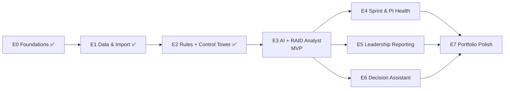

# 04 · Product Backlog (Execution)

**Status as of 2026-11-19 (updated after the generator audit):** Phases 0–2 ✅ Done · Phases 3–7 ⬜ To Do
**Estimation:** story points on a Fibonacci scale (1, 2, 3, 5, 8, 13). **Priority:** MoSCoW, measured against the MVP (Phases 0–3).

## 1. Epics mapped to phases and modules

| Epic | Phase | Functional module(s) | Goal | MoSCoW | Points | Status |
|---|---|---|---|---|---|---|
| E0 Foundations | 0 | All (platform) | Runnable skeleton, config, tests | Must | 8 | ✅ Done |
| E1 Data & Import | 1 | Data Import (supports all five modules) | Schema, synthetic data, validated import with lineage | Must | 34 | ✅ Done |
| E2 Rules Engine & Control Tower | 2 | **1. Delivery Control Tower** | Deterministic health and the non-AI MVP | Must | 34 | ✅ Done |
| E3 AI Foundation & RAID Analyst | 3 | **2. AI RAID Analyst**, AI Audit Log | Grounded AI pattern proven. **MVP complete** | Must | 42 | ⬜ To Do |
| E4 Sprint & PI Health | 4 | **3. Sprint & PI Health Analyser** | Predictability metrics and narrative | Should | 21 | ⬜ To Do |
| E5 Leadership Reporting | 5 | **4. AI Leadership Reporting** | Draft, approve and export a status report | Should | 21 | ⬜ To Do |
| E6 Decision Assistant | 6 | **5. Delivery Decision Assistant** | What-if analysis plus a decision register | Could | 26 | ⬜ To Do |
| E7 Portfolio Polish | 7 | All | CI, docs, demo, optional deployment | Should | 13 | ⬜ To Do |
| | | | | **Total** | **199** | |

## 2. User stories

Default persona: **DM** = Delivery Manager. Acceptance criteria use Given / When / Then.

### E0 · Foundations ✅

| ID | Story | Acceptance criteria | MoSCoW | Pts | Status |
|---|---|---|---|---|---|
| US-0.1 | As a developer, I want a runnable project skeleton so that work can start on a stable base | **Given** a fresh clone **When** I run `pip install -e ".[dev]"` and `pytest` **Then** the install succeeds and the tests pass | Must | 2 | ✅ Done |
| US-0.2 | As a DM, I want RAG thresholds in version-controlled config so that the health policy is transparent | **Given** `thresholds.yaml` **When** the thresholds are inverted or the weights don't sum to 1.0 **Then** loading fails with a clear error | Must | 3 | ✅ Done |
| US-0.3 | As a DM, I want the LLM provider configured separately, defaulting to mock, so that the app runs at no cost | **Given** there is no `llm.yaml` **When** the app loads **Then** the provider is `mock` and the source file is shown on Home | Must | 2 | ✅ Done |
| US-0.4 | As a DM, I want a home page showing the programme and config status so that I know what I'm looking at | **Given** the app is running **When** I open Home **Then** I see the programme, as-of date, rules version and LLM provider | Must | 1 | ✅ Done |

### E1 · Data & Import ✅

| ID | Story | Acceptance criteria | MoSCoW | Pts | Status |
|---|---|---|---|---|---|
| US-1.1 | As a developer, I want a relational schema for programme data so that records are related and constrained | **Given** an empty database **When** `init_db` runs **Then** all tables are created with foreign keys enforced | Must | 3 | ✅ Done |
| US-1.2 | As a DM, I want each import row validated (types, enums, dates) so that bad data never reaches the health rules | **Given** a row whose end date is before its start date **When** it's validated **Then** an error names the file, row, field and reason | Must | 5 | ✅ Done |
| US-1.3 | As a DM, I want references checked across files (squad, sprint, milestone) so that there are no orphan records | **Given** a RAID item with an unknown `squad_id` **When** it's validated **Then** a foreign-key error is reported for that row | Must | 3 | ✅ Done |
| US-1.4 | As a DM, I want imports to be all-or-nothing by default so that the database stays consistent | **Given** a file with any error **When** I import in strict mode **Then** no rows are written and the error report is shown | Must | 3 | ✅ Done |
| US-1.5 | As an auditor, I want every row to record its source file and row number so that facts are traceable | **Given** an imported record **When** I view it **Then** `import_batch_id` and `source_row` are filled in | Must | 3 | ✅ Done |
| US-1.6 | As a DM, I want re-importing the same file to have no effect so that duplicates can't appear | **Given** a file already imported **When** I import it again **Then** it's skipped as already imported, matched by file hash | Should | 2 | ✅ Done |
| US-1.7 | As a portfolio reviewer, I want realistic synthetic data for five squads so that every module has something to find | **Given** the seeded generator **When** it runs twice **Then** the CSVs are identical and the planned volumes and planted scenarios are present | Must | 8 | ✅ Done |
| US-1.8 | As a DM, I want to upload CSV or Excel files in the UI and see a row-level error report so that I can fix my data | **Given** the dirty sample file **When** I upload it **Then** a table lists each error by file, row, field and message | Must | 5 | ✅ Done |
| US-1.9 | As a DM, I want to browse imported records with their lineage so that I can check what was loaded | **Given** imported data **When** I pick a table **Then** I see its rows, counts and import history | Should | 2 | ✅ Done |

### E2 · Rules Engine & Delivery Control Tower ✅

| ID | Story | Acceptance criteria | MoSCoW | Pts | Status |
|---|---|---|---|---|---|
| US-2.1 | As a DM, I want sprint metrics (say/do, scope change, carry-over, velocity CV) calculated deterministically so that health is objective | **Given** commitment data **When** the rules run **Then** the values match hand-calculated fixtures | Must | 5 | ✅ Done |
| US-2.2 | As a DM, I want RAID hygiene flags (overdue, stale, unowned, unmitigated high risk) so that governance gaps surface | **Given** RAID-R-031 (score 20, no mitigation) **When** the rules run **Then** it's flagged | Must | 5 | ✅ Done |
| US-2.3 | As a DM, I want late and at-risk dependencies and milestones calculated from dates so that slippage is visible early | **Given** DEP-012 is past its needed-by date and not delivered **When** the rules run **Then** it's late and MS-07 is shown at risk | Must | 5 | ✅ Done |
| US-2.4 | As a DM, I want a composite squad RAG with weighted metrics so that I can compare squads | **Given** the synthetic data **When** health is calculated **Then** Payments is Green and Data Platform is Red | Must | 5 | ✅ Done |
| US-2.5 | As an auditor, I want health snapshots stored with their source IDs and rule version so that statuses are explainable | **Given** a snapshot **When** I inspect it **Then** `source_ids` and `rule_version` are filled in | Must | 3 | ✅ Done |
| US-2.6 | As a DM, I want a Control Tower page with a squad RAG grid, milestones, top risks and drill-down so that I see the programme at a glance | **Given** imported data **When** I open the Control Tower **Then** the grid renders and clicking a squad shows its source records | Must | 8 | ✅ Done |
| US-2.7 | As a DM, I want trend versus last sprint so that I can see direction, not just status | **Given** two snapshots **When** I view a metric **Then** an up or down indicator is shown | Could | 3 | ✅ Done |

### E3 · AI Foundation & RAID Analyst (MVP)

| ID | Story | Acceptance criteria | MoSCoW | Pts | Status |
|---|---|---|---|---|---|
| US-3.1 | As a developer, I want an `LLMProvider` interface with Mock, OpenAI-compatible and Anthropic implementations so that the model can be swapped by config | **Given** `provider: mock` **When** `complete()` is called **Then** valid JSON is returned with no network call | Must | 5 | ⬜ To Do |
| US-3.2 | As a DM, I want AI to receive only a fact pack with source IDs so that it can't use invented knowledge | **Given** a scope **When** the fact pack is built **Then** only in-scope records are included, each with a `source_id` and an overall hash | Must | 5 | ⬜ To Do |
| US-3.3 | As a DM, I want AI findings rejected if they cite unknown IDs so that invented records are never shown | **Given** a response citing `RAID-R-999` **When** it's validated **Then** that finding is dropped or marked unverified | Must | 5 | ⬜ To Do |
| US-3.4 | As a DM, I want numbers in AI text checked against the cited facts so that wrong figures are caught | **Given** "17 days overdue" when the fact says 12 **When** it's validated **Then** the finding is flagged | Must | 5 | ⬜ To Do |
| US-3.5 | As a DM, I want AI blocked from assigning RAG statuses so that the rules stay the single source of truth | **Given** "the squad is Red" when no rule says so **When** it's validated **Then** the finding is rejected | Must | 3 | ⬜ To Do |
| US-3.6 | As an auditor, I want every AI call logged (model, prompt version, fact-pack hash, validation result) so that outputs are reproducible | **Given** an AI run **When** I open the AI Audit Log **Then** the record and its citations are listed | Must | 5 | ⬜ To Do |
| US-3.7 | As a DM, I want a RAID Analyst page showing rule flags plus AI themes and mitigations with clickable citations so that I can act quickly | **Given** imported RAID data **When** I run the analysis **Then** the findings show citation chips that open the source records | Must | 8 | ⬜ To Do |
| US-3.8 | As a DM, I want duplicate RAID candidates detected so that the log stays clean | **Given** two near-identical risk titles **When** analysed **Then** they're listed as duplicate candidates | Should | 3 | ⬜ To Do |
| US-3.9 | As a developer, I want adversarial grounding tests so that validator regressions are caught | **Given** malformed or fabricated responses **When** the tests run **Then** every one is rejected or flagged | Must | 3 | ⬜ To Do |

### E4 · Sprint & PI Health Analyser

| ID | Story | Acceptance criteria | MoSCoW | Pts | Status |
|---|---|---|---|---|---|
| US-4.1 | As a Scrum Master, I want velocity, say/do and scope-change charts per squad so that I can coach the team | **Given** a squad **When** I select it **Then** charts for the last N sprints render from the rule outputs | Must | 5 | ⬜ To Do |
| US-4.2 | As a DM, I want PI objective achievement (actual vs. planned business value) so that I can track PI predictability | **Given** PI objectives **When** calculated **Then** the achievement % and RAG match the thresholds | Must | 5 | ⬜ To Do |
| US-4.3 | As a DM, I want an AI health narrative with root causes linked to evidence so that I understand *why* | **Given** a squad's health **When** the narrative is generated **Then** every sentence cites commitment or work-item IDs | Should | 8 | ⬜ To Do |
| US-4.4 | As a DM, I want capacity utilisation shown so that I can spot overload | **Given** capacity and commitment **When** calculated **Then** utilisation % is shown per sprint | Could | 3 | ⬜ To Do |

### E5 · AI Leadership Reporting

| ID | Story | Acceptance criteria | MoSCoW | Pts | Status |
|---|---|---|---|---|---|
| US-5.1 | As a Programme Lead, I want a report assembled from rule outputs (overall RAG, KPIs, milestones, top risks, decisions needed) so that it's factually consistent | **Given** current health **When** the report is assembled **Then** every figure matches the Control Tower | Must | 5 | ⬜ To Do |
| US-5.2 | As a DM, I want an AI-drafted executive summary with citations so that I save writing time | **Given** report data **When** the draft is generated **Then** each sentence has valid citations | Must | 5 | ⬜ To Do |
| US-5.3 | As a DM, I want to edit and approve the draft, with the approval logged, so that a human stays accountable | **Given** a draft **When** I approve it with my name **Then** `approved_by` and `approved_at` are stored | Must | 3 | ⬜ To Do |
| US-5.4 | As a DM, I want to export the approved report to Markdown or DOCX so that I can share it | **Given** an approved report **When** I export it **Then** a Markdown or DOCX file downloads with its citations | Should | 5 | ⬜ To Do |
| US-5.5 | As a DM, I want report export blocked until approval so that unreviewed AI text isn't shared | **Given** an unapproved draft **When** I try to export **Then** export is disabled | Should | 3 | ⬜ To Do |

### E6 · Delivery Decision Assistant

| ID | Story | Acceptance criteria | MoSCoW | Pts | Status |
|---|---|---|---|---|---|
| US-6.1 | As a DM, I want to choose a decision type (descope, add capacity, move milestone, accept risk, resequence a dependency) so that the analysis fits the problem | **Given** the page **When** I pick a type **Then** the relevant inputs are shown | Must | 3 | ⬜ To Do |
| US-6.2 | As a DM, I want a deterministic what-if calculation of the impact on capacity, dates and dependent items so that trade-offs are quantified | **Given** "descope feature X" **When** calculated **Then** freed points and affected dependencies are listed with IDs | Must | 8 | ⬜ To Do |
| US-6.3 | As a DM, I want AI option analysis (pros, cons, risks) with cited facts so that I can decide with evidence | **Given** the what-if result **When** the analysis is generated **Then** the options cite the source records | Should | 8 | ⬜ To Do |
| US-6.4 | As a Programme Lead, I want decisions logged to a register with a link to their AI output so that there's an audit trail | **Given** a chosen option **When** I save it **Then** a `decision` row stores the rationale, decider and `ai_output_id` | Must | 5 | ⬜ To Do |
| US-6.5 | As a DM, I want to compare two options side by side so that the trade-offs are clear | **Given** two options **When** I compare them **Then** a side-by-side table is shown | Could | 2 | ⬜ To Do |

### E7 · Portfolio Polish

| ID | Story | Acceptance criteria | MoSCoW | Pts | Status |
|---|---|---|---|---|---|
| US-7.1 | As a reviewer, I want CI running ruff and pytest on every push so that quality is visible | **Given** a push **When** GitHub Actions runs **Then** lint and tests pass with no secrets | Should | 3 | ⬜ To Do |
| US-7.2 | As a hiring manager, I want a README with an architecture diagram, screenshots and a demo script so that I understand the project in 5 minutes | **Given** the repo **When** I read the README **Then** setup takes one command block and the demo steps are clear | Must | 3 | ⬜ To Do |
| US-7.3 | As a reviewer, I want an optional public demo on Streamlit Community Cloud using the mock provider so that I can try it without installing anything | **Given** the deployed URL **When** I open it **Then** the demo data loads with no API key | Could | 3 | ⬜ To Do |
| US-7.4 | As a developer, I want an optional live-LLM evaluation script so that real model grounding can be measured | **Given** a configured provider **When** the script runs **Then** the citation-validity and rejection rates are reported | Could | 4 | ⬜ To Do |

## 3. Definition of Ready

A story is ready to start when:

| # | Criterion |
|---|---|
| 1 | It is written as a user story with a clear persona and value |
| 2 | It has Given/When/Then acceptance criteria that can be tested |
| 3 | It is estimated in story points, and 8 points or fewer (larger stories are split) |
| 4 | Its dependencies on other stories or epics are identified and done, or not blocking |
| 5 | Any data it needs (synthetic entities or fields) is identified in the schema |
| 6 | For AI stories: the fact-pack contents and output schema are defined |

## 4. Definition of Done

A story is done when:

| # | Criterion |
|---|---|
| 1 | All acceptance criteria pass |
| 2 | Unit tests are written and the full `pytest` suite passes |
| 3 | `ruff check .` reports no errors |
| 4 | Rule logic has boundary tests, and AI features have grounding tests, including adversarial cases |
| 5 | No AI path can assign a RAG status or show an uncited fact |
| 6 | UI changes are checked in the running Streamlit app, and the page smoke test passes |
| 7 | Traceability is kept: new records or outputs carry source IDs or lineage |
| 8 | Docs are updated (README or `docs/`) and an evidence log entry is added |
| 9 | No real client, employer or personal data is introduced |

## 5. Complexity and effort (from the approved plan)

| Component | Complexity | Effort |
|---|---|---|
| Foundations and config | Low | 0.5 day |
| Schema, repositories, ingestion and validation | Medium | 2–3 days |
| Synthetic data generator | Medium | 2 days |
| Rules engine and health scoring | Medium | 2–3 days |
| Control Tower UI | Low–Medium | 1.5 days |
| AI layer (providers, fact packs, grounding, audit) | **High** | 3–4 days |
| RAID Analyst | Medium | 1.5 days |
| Sprint & PI Health | Medium | 2 days |
| Leadership Reporting | Medium | 2 days |
| Decision Assistant | Medium–High | 2–3 days |
| Testing, CI, docs and polish | Medium | 3 days |
| **Total** | | **~22–28 focused days**. MVP (Phases 0–3) ~11–14 days |

The story-point totals in §1 are relative sizes for backlog ordering. The day estimates above are the plan's planning baseline.
