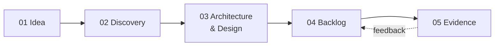

# Product Documentation

This is the product documentation for the **AI Agile Delivery Manager Assistant**, covering its journey from idea through discovery to execution. It's written to show *how* the product was shaped, not just what it does.

| # | Document | Stage | What's inside |
|---|---|---|---|
| 01 | [Product Vision](01_product_vision.md) | Idea | Problem, personas, value proposition, goals, non-goals, success measures |
| 02 | [Discovery](02_discovery.md) | Discovery | Requirements analysis, stakeholder Q&A, assumptions, risks, open questions |
| 03 | [Architecture & Solution Design](03_architecture_and_solution_design.md) | Design | Architecture diagrams, anti-hallucination contract, lineage, ER diagram, synthetic data, LLM abstraction, testing, ADRs |
| 04 | [Product Backlog](04_product_backlog.md) | Execution | Epics by phase and module, user stories with acceptance criteria, MoSCoW, points, status, Definition of Ready and Done |
| 05 | [Delivery Evidence Log](05_delivery_evidence_log.md) | Execution | Dated activities with quoted command outputs and artefact lists per phase |

**Current status (2026-11-23):** Phases 0–3 ✅ Done (MVP complete) · Phase 5 🟡 agent built, export To Do · Phases 4, 6, 7 ⬜ To Do

**Core principle:** *rules compute, AI interprets.* Every metric and RAG status is deterministic and tested. AI explains using cited source records only.
